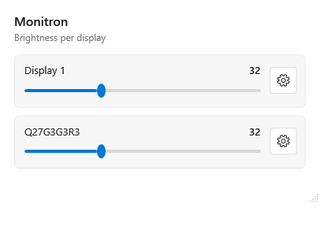
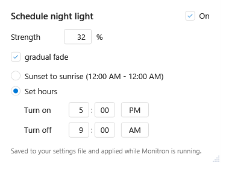
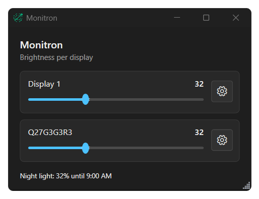

<p align="center"></p>

# Monitron

**Brightness for every monitor — and a night light that dims them for you.**

Monitron sits in your notification area, next to the clock. It gives each of your screens its own
brightness slider, and it can dim them all on a schedule — fade down in the evening, hold the low
level overnight, and put every screen back the way it was in the morning.

<p align="center">
  
  
</p>

<p align="center">
  
</p>

<p align="center"><em>The same window in Windows' dark theme, with the night light running.</em></p>

## What it does

- **A slider for every screen.** Your main monitor bright, your second one dim — each keeps its own
  level. External monitors and laptop panels both work.
- **A night light that remembers.** Choose a start time, an end time, how dim to go at night, and how
  bright to come back in the morning. Monitron fades down when the night begins and eases every
  screen back up to your daylight level — so nothing is left dark when you don't expect it.
- **Out of the way.** Close the window and it keeps running from the tray. Open it again from the
  tray icon whenever you like, or switch on *Run on Windows startup*.
- **Matches your PC.** The windows follow your Windows light or dark theme, and it carries its own
  icon.

## Using it

1. **Set a screen** — drag its slider.
2. **Set the night light** — click the gear on a row, switch it on, and pick the hours and the two levels (night and daylight).
3. **Leave it running** — close the window; the tray icon brings it back, or quits it.

## Getting it

Download **`Monitron.exe`** from the [latest release](https://github.com/Magid-William/Monitron/releases/latest)
and run it — a single program, no installer, nothing to install alongside it. It runs on Windows 10
and 11 as they come.

The release is **unsigned** — there is no code-signing certificate yet — so Windows SmartScreen may
say *"Windows protected your PC"* the first time: choose **More info** → **Run anyway**. The release
page prints the SHA-256, which `Get-FileHash .\Monitron.exe -Algorithm SHA256` should match.

Build it yourself instead:

```powershell
pwsh -File src\Monitron.App\build.ps1
.\src\Monitron.App\Monitron.App.exe
```

## For developers

The app is C# / WPF, written in code only (no XAML), and built with the .NET Framework 4.8 compiler
that ships with Windows.

Every claim in the project is verified by **driving** the real thing rather than describing it: the
headless `*-test.ps1` suites assert the state machines with an injected clock, and the `verify-*.ps1`
scripts drive the real windows through UI Automation and read the real displays.

The work is organised as one hypothesis per experiment, on its own branch, with a written record —
the log is [`experiments-overview.md`](experiments-overview.md) and the prior-art research is in
[`docs/prior-art/`](docs/prior-art/).

## License

MIT — see [`LICENSE`](LICENSE).
